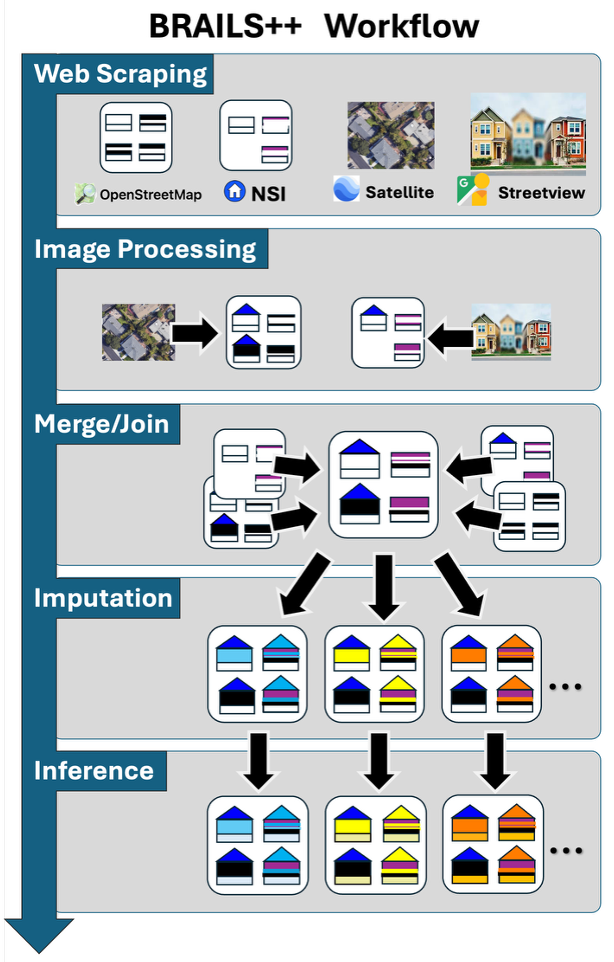

# BRAILS++: Building Regional Asset Inventories for Large Scale Simulation

[](https://github.com/NHERI-SimCenter/BrailsPlusPlus/actions/workflows/tests.yml)
[](https://doi.org/10.5281/zenodo.15610728)
[](https://pypi.org/project/BRAILS/)
[](https://pypi.python.org/pypi/BRAILS/)

## What is it?

```BRAILS++``` is an object-oriented framework for building applications that focus on generating asset inventories for large geographic regions.


 BRAILS++ provides modular workflows for generating inventories by integrating diverse data sources, including public datasets, features extracted from imagery, and ruleset-based inference models.

From version 5.0.0, BRAILS++ also provides dedicated Compilers for building inventories. The first such compiler is designed for Hazus
earthquake damage and loss assessments: [Hazus earthquake inventories](#hazus-earthquake-inventories).



In BRAILS++, an asset inventory consists of geographically referenced points, line-strings, or polygons, each annotated with key attributes. To build these inventories, the data scrapers in BRAILS++ interact with web servers to create an inventory blueprint suitable as a starting point for regional-scale analysis. Example datasets accessed through BRAILS++ include FEMA’s USA Structures (FEMA, 2022), Microsoft Footprints (Microsoft, 2022), Overture Maps (Overture Maps Foundation, 2023), OpenStreetMap (OpenStreetMap contributors, 2017), the U.S. Army Corps of Engineers’ NSI, TIGER/Line roadway and boundary data and American Community Survey tables (U.S. Census Bureau, 2024), FHWA’s National Bridge and Tunnel Inventories (FHWA, 2023; FHWA, 2024), ASCE REST services for design loads (ASCE, 2025), and HIFLD infrastructure data (U.S. Department of Homeland Security, 2024).

Despite their value, these datasets often contain incomplete or inconsistent information, requiring further enhancement to address the corresponding uncertainties. BRAILS++ incorporates methods for handling missing data and enhancing the available datasets through modules that enable: 1) feature extraction from publicly available images, e.g. Google Street View; 2) inventory merging to integrate metadata from various sources and resolve inconsistencies, such as differing metadata values or spatial issues e.g. misaligned footprints; 3) statistical imputation to generate plausible inventories with all features defined for all assets given some assets will have missing features and finally 4) data inference to add asset attributes for which no information exists in the inventory, e.g. building codes applicable at the time of construction can be used to infer typical connection details (Kijewski-Correa et al., 2022) such as roof-to-wall connections for wind vulnerability assessments.

## Hazus earthquake inventories

The Hazus earthquake inventory compiler, `HazusEQInventoryCompiler` in
`brails.compilers`, builds the building inventory that a Hazus earthquake damage and
loss assessment reads. Given a city or county with its state, `compile_place` reads
the building footprints of Overture Maps, the records of the National Structure
Inventory, the census block groups and American Community Survey tables of the U.S.
Census Bureau, and the mobile-home parks of the Homeland Infrastructure
Foundation-Level Data (HIFLD). The inventory holds several possible worlds: versions
of the inventory that differ only in the values drawn at random, such as the year a
building was built.

Each compilation needs the seismic zone of the study area in the 1997 Uniform
Building Code, and reading the census tables needs a Census API key, which the Census
Bureau issues free of charge. The compiler draws structure types from the West Coast
tables of Hazus, so it accepts only states of that region. The section "Scope" of its
README states the limits.

Two notebooks in `examples/hazus_eq_compiler/` show how to compile an inventory and
how to prepare one for R2D. The compiler is documented in README files beside the code. Start with
[`brails/compilers/README.rst`](brails/compilers/README.rst), which defines the terms
the other pages share, such as possible worlds and frozen stages, then
[`brails/compilers/hazus_earthquake/README.rst`](brails/compilers/hazus_earthquake/README.rst),
which states what the compiler produces and from which inputs, the run step by step,
and the file it writes. Each main step of the compiler has a page of its own, which
states what the step does, how, and where its packaged values come from, including
the benchmarks against which some of them were calibrated:

- Scrapers: [Overture Maps](brails/scrapers/overture_maps_scraper/README.rst),
  [National Structure Inventory](brails/scrapers/nsi_parser/README.rst),
  [American Community Survey tables](brails/scrapers/us_census_scrapers/README.rst),
  [mobile-home parks](brails/scrapers/mobile_home_park_scraper/README.rst).
- Aggregators: [stacked-footprint merge](brails/aggregators/stacked_footprints/README.rst).
- Inferers: [overview](brails/inferers/README.rst),
  [stories from footprint height](brails/inferers/stories_from_height_inferer/README.rst),
  [ACS unit budget](brails/inferers/acs_unit_budget/README.rst),
  [ACS year-built sampler](brails/inferers/acs_year_built_sampler/README.rst),
  [Hazus earthquake inventory tables](brails/inferers/hazus_inferer_earthquake/README.rst).
- Imputers: [overview](brails/imputers/README.rst),
  [observed-donor imputer](brails/imputers/observed_donor_imputer/README.rst),
  [replacement cost imputer](brails/imputers/replacement_cost/README.rst),
  [residential neighbor year sampler](brails/imputers/residential_neighbor_year_sampler/README.rst).

## How is the repo laid out?

+ ```brails```: A directory containing the classes
  - ```brails/types```: directory containing useful datatypes, e.g., ```ImageSet``` and ```AssetInventory```
  - ```brails/processors```: directory containing classes that do ```image_processing``` to make predictions, e.g. RoofShape
  - ```brails/scrapers```: directory containing classes that do internet downloads, e.g., footprint and image scrapers.
  - ```brails/filters```: directory containing image filters, e.g., classes that take images and revise or filter out unnecessary portions of images.
  - ```brails/aggregators```: directory containing classes for doing merge, join and allocation operations, e.g., combining data from different datasets (inventories or other) to create a single inventory.  
  - ```brails/imputers```: directory containing classes that fill in missing ```AssetInventory``` datasets, i.e., filling in features that are missing in certain Assets of the AssetInventory.
  - ```brails/inferers```: directory containing classes that infer new asset features based on existing features in the Assets of ```AssetInventory```.
  - ```brails/compilers```: directory containing classes that build the inventory an assessment method reads, by running a sequence of steps, e.g., the Hazus earthquake inventory compiler.
  - ```brails/validators```: directory containing classes that check an inventory against the input requirements of a method.
  - ```brails/utils```: directory containing misc classes that do useful things, e.g. geometric conversions
+ ```examples```: A directory containing example scripts and Jupyter notebooks
+ ```tests```: A directory containing unit tests. The directory structure follows that of ```brails```

## Quick Links

- [Documentation & Guides](https://nheri-simcenter.github.io/BrailsPlusPlus/)

## Installation

BRAILS++ runs on Python 3.10, 3.11 and 3.12. It installs large packages such as
PyTorch, so install it in a new virtual environment. To install the latest release
from PyPI, run:

   ```
   pip install brails
   ```

> **Note**  
> To install the package from GitHub, run:
>
> ```shell
> pip install git+https://github.com/NHERI-SimCenter/BrailsPlusPlus
> ```
>  If it's already installed and you want to update:
>
> ```shell
> pip install --upgrade git+https://github.com/NHERI-SimCenter/BrailsPlusPlus
> ```      

## Acknowledgments

This work is based on material supported by the National Science Foundation under grants CMMI 1612843 and CMMI 2131111.

## Contributors

Want to see who made this possible? Check out the full list of contributors [here](./contributors.md).

## Contact

NHERI-SimCenter nheri-simcenter@berkeley.edu

<!-- todo: instructions on how to lint the code, and specific subfolder or file. -->
<!-- todo: example with the test suite. -->
<!-- todo: instructions on how to run the tests -->
<!-- todo: instructions on how to check coverage -->
<!-- python -m pytest tests --cov=brails --cov-report html -->
